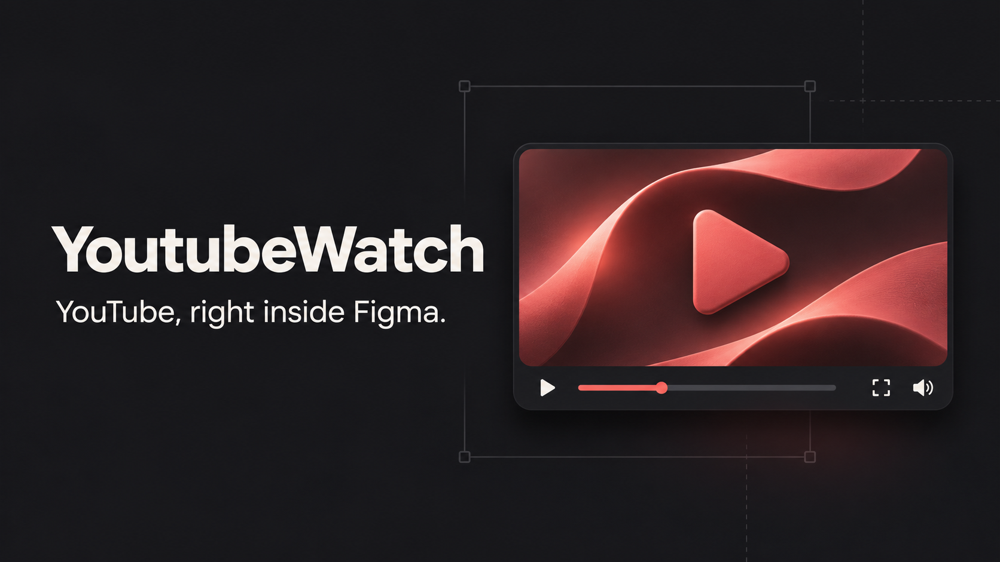

# YoutubeWatch

Watch YouTube videos right inside Figma.

**[Open in Figma Community](https://www.figma.com/community/plugin/1441766262549436446/youtubewatch)** · [English](#english) · [Русский](#russian)



<a id="english"></a>

## English

YoutubeWatch is a compact YouTube player for Figma Design. Keep a tutorial, design talk, or reference video beside your work and control playback without switching tabs to watch.

### Features

- Play, pause, and seek from a compact control bar.
- Adjust volume and toggle mute.
- Use **Fit** to match the window to the video's proportions.
- Automatically hide the link toolbar during playback and bring it back when needed.
- Resize the window by dragging its bottom-right corner.
- Open standard YouTube links, `youtu.be` links, Shorts, live videos, embed links, and video IDs.
- Start from a timestamp included in the link.

### Get the plugin

Open **[YoutubeWatch in Figma Community](https://www.figma.com/community/plugin/1441766262549436446/youtubewatch)** and run it in a Figma Design file.

### How to use

1. Paste a link into **YouTube link** and press Enter or the load button. You can also select **Try demo**.
2. Press **Play** in the bottom control bar or inside the video.
3. Adjust the volume, seek, or use **Fit** to resize the window to the video.

The link toolbar hides when playback starts. Use the arrow in the bottom bar to show it again. The reload button reloads the current video; the external-link button opens it on YouTube.

**Fit** uses the video's dimensions when available and falls back to 16:9. It cannot remove black borders already encoded into a video. YouTube determines the branding and overlays displayed within its player.

### Local development

Requirements: Node.js 20 or later, npm, and the Figma desktop app.

```sh
npm ci
npm run build
```

In a Figma Design file, select **Plugins → Development → Import plugin from manifest…**, choose `manifest.json` from this repository, and run **YoutubeWatch**.

The generated `ui.html` and `player.html` are included in the repository. After changing files in `src/`, rebuild and restart the plugin.

To preview the interface in a browser:

```sh
npm run preview
```

Open `http://127.0.0.1:4173`.

The embedded player page is hosted at `https://themickart.github.io/YoutubeWatch/player.html`. When updating it, publish the generated `player.html` with the rest of the project and wait for the GitHub Pages deployment to finish. GitHub Pages should serve the repository root.

### Tests

```sh
npm test
npm run test:browser
```

Browser tests require Google Chrome and use mocked YouTube responses.

### Project structure

| Path | Purpose |
| --- | --- |
| `manifest.json` | Figma plugin manifest |
| `code.js` | Plugin window and resizing |
| `ui.html` | Generated plugin interface |
| `player.html` | Generated player page for GitHub Pages |
| `src/` | Interface, player, and link-processing source files |
| `scripts/` | Build and local preview scripts |
| `tests/` | Unit and browser tests |
| `assets/community/` | Community cover, description, and release notes |

### Requirements and limitations

An internet connection and the published player page are required. Videos with embedding restrictions, private access, or age restrictions may be unavailable.

### Feedback

[Report a bug or request a feature](https://github.com/themickart/YoutubeWatch/issues).

### License

[MIT](LICENSE).

---

<a id="russian"></a>

## Русский

YoutubeWatch — компактный YouTube-плеер для Figma Design. Смотрите уроки, выступления и видео для вдохновения рядом с макетом и управляйте воспроизведением без переключения вкладок.

### Возможности

- Воспроизведение, пауза и перемотка из компактной нижней панели.
- Регулировка громкости и выключение звука.
- Кнопка **Fit** для подгонки окна под пропорции видео.
- Автоматическое скрытие строки ссылки при воспроизведении с возможностью вернуть её.
- Изменение размера окна перетаскиванием нижнего правого угла.
- Поддержка обычных YouTube-ссылок, `youtu.be`, Shorts, live, embed-ссылок и ID видео.
- Запуск с отметки времени, указанной в ссылке.

### Установка

Откройте **[YoutubeWatch в Figma Community](https://www.figma.com/community/plugin/1441766262549436446/youtubewatch)** и запустите плагин в Design-файле Figma.

### Использование

1. Вставьте ссылку в поле **YouTube link** и нажмите Enter или кнопку загрузки. Для проверки можно выбрать **Try demo**.
2. Нажмите **Play** в нижней панели или внутри видео.
3. Настройте громкость, перемотайте видео или нажмите **Fit**, чтобы подогнать окно под его пропорции.

При запуске видео строка ссылки скрывается. Стрелка в нижней панели возвращает её. Кнопка перезагрузки повторно загружает текущее видео, а кнопка внешней ссылки открывает его на YouTube.

**Fit** использует размеры видео, если они доступны; иначе применяется 16:9. Полосы, уже встроенные в само видео, не удаляются. Брендинг и элементы внутри плеера определяет YouTube.

### Локальная разработка

Требуются Node.js 20 или новее, npm и настольное приложение Figma.

```sh
npm ci
npm run build
```

В Design-файле выберите **Plugins → Development → Import plugin from manifest…**, укажите `manifest.json` из репозитория и запустите **YoutubeWatch**.

Готовые `ui.html` и `player.html` включены в репозиторий. После изменения файлов в `src/` пересоберите проект и перезапустите плагин.

Предпросмотр интерфейса в браузере:

```sh
npm run preview
```

Откройте `http://127.0.0.1:4173`.

Страница плеера размещена по адресу `https://themickart.github.io/YoutubeWatch/player.html`. При обновлении публикуйте сгенерированный `player.html` вместе с остальными файлами и дождитесь завершения публикации GitHub Pages. Pages должен раздавать корень репозитория.

### Тесты

```sh
npm test
npm run test:browser
```

Для браузерных тестов нужен Google Chrome. Ответы YouTube в них подменяются тестовыми данными.

### Структура проекта

| Путь | Назначение |
| --- | --- |
| `manifest.json` | Манифест плагина Figma |
| `code.js` | Окно плагина и изменение его размера |
| `ui.html` | Собранный интерфейс плагина |
| `player.html` | Собранная страница плеера для GitHub Pages |
| `src/` | Исходники интерфейса, плеера и обработки ссылок |
| `scripts/` | Сборка и локальный предпросмотр |
| `tests/` | Модульные и браузерные тесты |
| `assets/community/` | Обложка, описание и заметки о выпуске |

### Требования и ограничения

Для работы нужны интернет и опубликованная страница плеера. Видео с запрещённым встраиванием, закрытым доступом или возрастными ограничениями могут быть недоступны.

### Обратная связь

[Сообщить об ошибке или предложить улучшение](https://github.com/themickart/YoutubeWatch/issues).

### Лицензия

[MIT](LICENSE).
